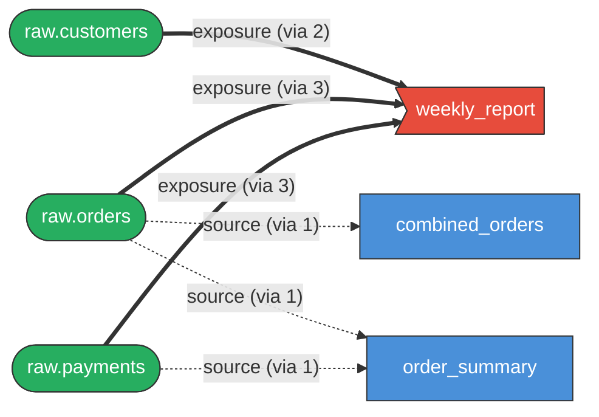
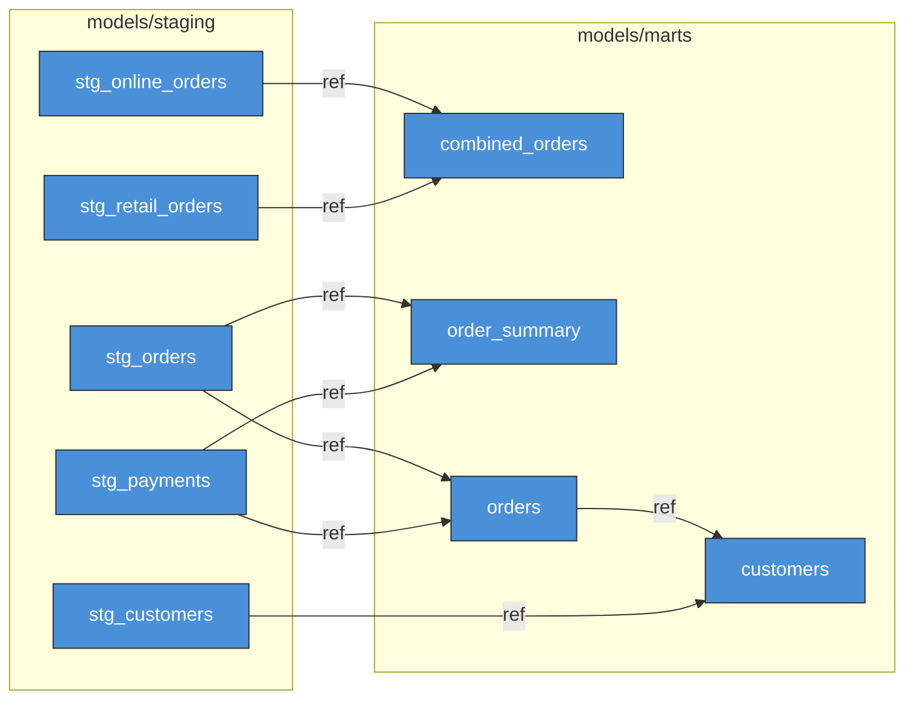
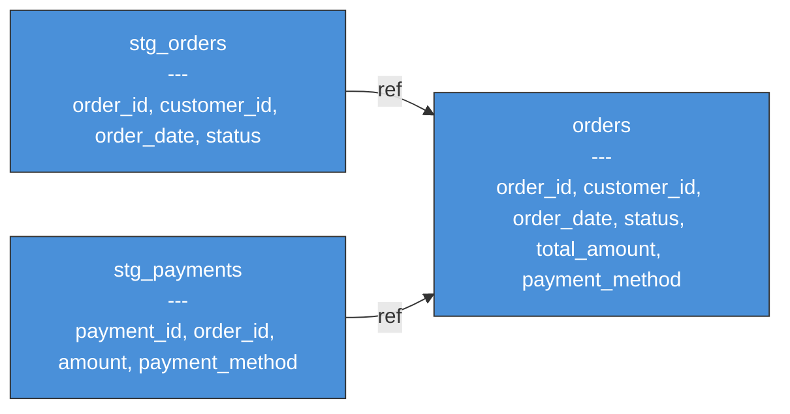
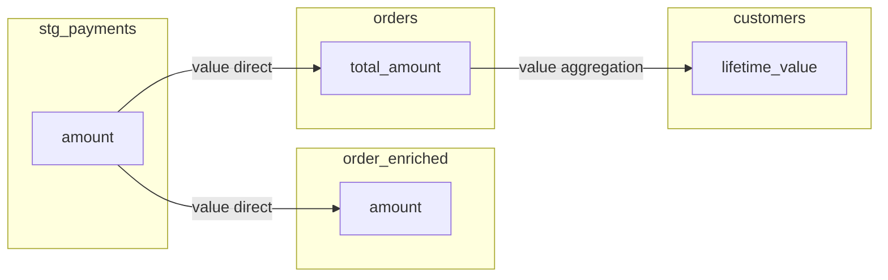

# dlin

[](https://crates.io/crates/dlin)
[](https://pypi.org/project/dlin-cli/)
[](https://deepwiki.com/eitsupi/dlin)

dbt model lineage CLI. Parses SQL files directly or reads a compiled `manifest.json`. No Python required.

Works for developers navigating live SQL files, analysts exploring a shared manifest, AI agents via CLI prompt or MCP server, and CI pipelines.

Column-level lineage (`dlin column upstream` / `dlin column downstream`) requires a compiled `manifest.json` and is usable in practice while remaining Experimental for coverage reasons.

## Motivation

When I edited dbt models in VS Code, [dbt Power User](https://marketplace.visualstudio.com/items?itemName=innoverio.vscode-dbt-power-user) was my go-to companion for navigating lineage. AI agents have no such companion. I watched them `grep` through dbt projects to find model dependencies. It works, but they end up calling `grep` repeatedly and relying on fragile string matching to piece together `ref()` and `source()` relationships.

dlin is designed to fill that gap: a CLI tool that lets AI agents understand a dbt project's structure without falling back to `grep`. It is equally useful for humans, and its stdin/stdout interface makes it easy to combine with `jq`, `git diff`, and other CLI tools.

To replace `grep`, speed and size matter. dlin is a small, self-contained binary with no runtime dependencies. It parses SQL directly, interprets the Jinja that selects dependencies without Python, parallelizes file I/O, and caches manifest and column-lineage analysis.

The key idea behind dlin is that finding the right models fast is what matters most. The hard part for agents is knowing which models to look at in the first place. dlin focuses on making model-level lineage fast and provides column-level lineage for deeper analysis.

## Install

### Cargo (Rust)

```sh
cargo install dlin
```

### pip / uv (Python)

For convenience, dlin is also available as a Python package. The installed binary is native and does not require Python at runtime.

```sh
pip install dlin-cli   # or: uv tool install dlin-cli
```

### GitHub Releases

Pre-built binaries for Linux, macOS, and Windows are available on the [Releases](https://github.com/eitsupi/dlin/releases) page. You can also use the installer scripts:

macOS / Linux:

```sh
curl --proto '=https' --tlsv1.2 -LsSf https://github.com/eitsupi/dlin/releases/latest/download/dlin-installer.sh | sh
```

Windows (PowerShell):

```powershell
powershell -ExecutionPolicy Bypass -c "irm https://github.com/eitsupi/dlin/releases/latest/download/dlin-installer.ps1 | iex"
```

## Quick start

```sh
# Full lineage graph
dlin graph -p path/to/dbt/project

# Downstream impact analysis
dlin impact orders

# List models as JSON
dlin list -o json --json-fields unique_id,file_path

# Pipe changed files into lineage
git diff --name-only main | dlin graph -o json
```

## Source modes

dlin supports two source modes for model-level commands.

**SQL parse mode (default)** is for developers editing a live dbt project. It interprets the Jinja in SQL files and in YAML dependency expressions to find `ref()` and `source()` calls without waiting for `dbt compile`, so model-level lineage quickly identifies the related models. Read the relevant SQL for exact transformation behavior.

**Manifest mode** (`--source manifest`) is for analysts or agents analyzing compiled state rather than editing live SQL. A developer compiles once and shares `manifest.json`; users explore the resolved graph without SQL or Python. Use column-level lineage when a field-level trace is needed; it requires the compiled manifest.

```sh
# SQL parse mode: reads SQL files directly (default)
dlin graph orders

# Manifest mode: reads manifest.json only
dlin graph orders --source manifest
dlin summary --source manifest
```

For model-name inputs, `manifest.json` is the only file needed in manifest mode. File-path inputs (e.g. `models/foo.sql`) fall back to standard dbt directory layout when `dbt_project.yml` is absent, which may not match projects with custom path configuration. (`check-manifest` always requires a full project.)

### Limitations of SQL parse mode

- `var()` resolves from `vars.yml` or `dbt_project.yml`, then its default (`--vars` CLI overrides not supported)
- `env_var()` uses its default and never reads the environment. A different value at run time can select a different dependency or branch than the one shown
- Values known only at run time (`target`, `env_var()` without a default, `run_query()` results) do not select dependencies; `execute` is false, as when dbt parses the project
- Dependencies selected through `adapter.dispatch()` or namespaced package macros (e.g. `dbt_utils.*`) may be missed. The nodes concerned are reported as partial (see [Completeness of model-level dependencies](#completeness-of-model-level-dependencies))
- Generic test IDs are dlin-specific (e.g. `test.not_null.orders.order_id`) and do not match dbt's naming; use manifest mode when exact test IDs matter

When these limitations matter, use `--source manifest`.

## AI agent integration

### CLI approach

Recommended for developers with access to a live dbt project. Works with SQL parse mode (no `dbt compile` needed) as well as manifest mode.

Install dlin and add the following to your `AGENTS.md`, `CLAUDE.md`, or system prompt:

````md
## dbt project structure analysis

Use `dlin` to explore dbt model dependencies.
Do NOT grep/cat/find through SQL files.

```bash
dlin summary                                           # Project overview (start here)
dlin graph <model> -u 2 -d 1 -q                        # Upstream/downstream lineage
dlin impact <model>                                    # Downstream impact with severity
dlin list -o json --json-fields unique_id,sql_content  # Read SQL content
git diff --name-only main | dlin graph -q              # Lineage of changed files
```

For full option reference: `dlin --help`, `dlin graph --help`, etc.
````

The key line is **"Do NOT grep/cat/find through SQL files"**. Without it, agents default to familiar tools. `dlin --help` is designed for tool discovery, so the prompt can stay minimal.

### MCP server (experimental)

For analysts and agents who work from a distributed `manifest.json` without access to the full project. Runs in manifest mode only.

`dlin mcp` exposes a stdio MCP server that AI assistants supporting MCP can connect to directly.

```sh
dlin mcp --manifest-path path/to/manifest.json
```

Tools return compact JSON as a single text result. Use `get_project_summary` to check manifest freshness and loading diagnostics. Lineage and impact results distinguish confirmed paths from possible paths and show where analysis could not continue. Request `detail: "full"` for paths and evidence, or follow `page.next_cursor` with the same query for more rows. Use `include_sql: true` with `find_nodes` to request compiled SQL.

The SQL dialect for column lineage is detected from the manifest's `adapter_type`; `--dialect` overrides it. Requires a compiled `manifest.json` (`dbt compile`).

## Features

- **SQL parse mode**: single binary, no Python, no `manifest.json` needed for model-level lineage
- **Manifest mode**: works from `manifest.json` alone; useful for analysts or agents without a full project checkout
- **MCP server** (experimental): `dlin mcp` serves lineage data via stdio MCP for direct AI assistant integration
- **Recursive upstream / downstream**: `-u N` / `-d N` to control traversal depth
- **Impact analysis with severity**: `dlin impact` scores downstream nodes and flags exposure reachability
- **Composable**: stdin accepts model names or file paths; pipe with `jq`, `dlin list`, `git diff`, etc.
- **Agent-friendly**: `--error-format json` emits structured `{"level","what","why","hint"}` on stderr; `--help` is designed for tool discovery
- **Column-level lineage** (experimental): traces columns across models with transformation classification, reports partial results, where tracing stopped and the assumptions it relied on; requires `manifest.json`

## Mermaid diagrams

dlin outputs Mermaid flowcharts that render natively on GitHub, GitLab, Notion, and other Markdown environments.

### Simplified graphs with `--collapse`

Automatically remove intermediate nodes to see just the endpoints (nodes with no predecessors or no successors); everything in between becomes transitive "(via N)" edges:

```sh
# Collapse intermediate models; only endpoints remain
dlin graph --collapse -o mermaid

# Focal mode: keep only sources, exposures, and specified focus models
# (ignores BFS window pseudo-endpoints; works best with -u/-d limits)
dlin graph orders --collapse=focal -u 3 -o mermaid
```



Positional focus models are always preserved during collapse, so `dlin graph orders --collapse` keeps `orders` even if it would otherwise be intermediate.

### Pipe to build focused diagrams

Combine `dlin list`, `jq`, and `dlin graph` to extract exactly the nodes you want:

```sh
# Staging models → 1 hop downstream, models only, grouped by directory
dlin list -s 'path:models/staging' -o json | jq -r '.[].label' |
  dlin graph -d 1 --node-type model --group-by directory -o mermaid
```



### Column names in nodes with `--show-columns`

Add `--show-columns` to include column names inside Mermaid node labels, useful for understanding what each model produces at a glance:

```sh
dlin graph orders -u 1 -d 0 --show-columns --node-type model,source -o mermaid
```



Combines well with `--collapse` to show rich detail on fewer endpoint nodes.

### Other graph options

```sh
dlin graph orders -u 2 -d 1                            # focus on specific model
dlin graph -o mermaid --collapse --show-columns        # columns in collapsed nodes
dlin graph orders --collapse=focal -u 3 -o mermaid    # focal: sources + exposures + orders
dlin graph -o mermaid --group-by directory             # group by directory
dlin graph -o mermaid --direction tb                   # top-to-bottom layout
dlin graph --node-type source,exposure                 # filter by node type
dlin graph -o dot | dot -Tsvg > out.svg                # Graphviz rendering
```

Output formats: ASCII (default), JSON, Mermaid, Graphviz DOT, Plain, SVG, HTML.

## Column-level lineage (Experimental)

`dlin column upstream` and `dlin column downstream` trace columns across models. They require a compiled `manifest.json`, so run `dbt compile` first. Regression fixtures and real dbt project validation show that column-level lineage is usable in practice. Experimental reflects the Rust stack's shorter production history and remaining cross-dialect and complex-SQL coverage gaps, not a prototype-only status.

Output is JSON by default; `-o plain` is easier to read, and `-o mermaid` / `-o dot` draw diagrams.

```sh
# Where does each output column of orders come from?
dlin column upstream orders -o plain

# What downstream columns are affected if stg_orders.order_id changes?
dlin column downstream stg_orders --column order_id

# Mermaid flowchart
dlin column upstream customers -o mermaid
dlin column downstream stg_orders --column order_id -o mermaid

# Specific columns only
dlin column upstream orders --column order_id --column status

# Verify manifest freshness before querying
dlin check-manifest && dlin column upstream orders
```

### Column upstream

Traces each output column of a model back to its source columns, following references across intermediate models. Output columns are listed in SQL order; duplicate names and identifier quoting are kept.

```sh
dlin column upstream customers --column order_count --column lifetime_value -o plain
```

```
customers (2 columns listed: 2 complete, 0 partial)
  order_count     →  raw.orders.id → stg_orders.order_id → orders.order_id (aggregation)
                       boundary: external relation at stg_orders.order_id for customers.order_count: raw.orders (source, policy: snapshot unsupported; seed external)
  lifetime_value  →  raw.payments.amount → stg_payments.amount → orders.total_amount (aggregation)
                       boundary: external relation at stg_payments.amount for customers.lifetime_value: raw.payments (source, policy: snapshot unsupported; seed external)
  assumes yaml:source.clp.raw.orders (YAML columns taken as exhaustive): order_count
  assumes yaml:source.clp.raw.payments (YAML columns taken as exhaustive): lifetime_value
```

Each column's lineage is `complete`, or `partial` when some contributions could not be resolved. A partial column keeps its known sources and lists the unresolved parts with a reason (for example a column hidden behind an unexpanded `SELECT *`, an ambiguous name, or unsupported syntax).

A `boundary` line says where tracing stopped and why. Reaching a source, seed or other external relation, or a constant, is a legitimate end. A model that failed analysis, a missing definition, a cycle, an ambiguous model name or a snapshot is an incomplete stop, and the column stays partial.

An `assumes` line names a schema the result relies on without proof. By default, a column list declared in YAML is taken as the full list of columns, and the line shows which conclusions depend on that.

Transformation types: `direct`, `aggregation`, `expression`, `cast`, `conditional`, `unknown`.

### Column downstream

Finds the downstream models and columns whose values depend on a column.

```sh
dlin column downstream stg_payments --column amount -o mermaid
```



`stg_payments.amount` flows directly into `orders.total_amount` and `order_enriched.amount`, and `orders.total_amount` is aggregated into `customers.lifetime_value`.

Results are split into `confirmed` impacts, `possible` impacts reached through a finite set of candidates (such as an ambiguous name), and an `exploration` status that says whether the search was complete. No impact is concluded only when nothing is confirmed or possible and the exploration is complete. Only value dependencies are reported; columns used only in filter predicates and join conditions (row dependencies) are not collected yet.

### Performance benchmark

Correctness-gated means from the synthetic scalability run (3 runs, 1 warmup):

| Workload | dlin 0.2.4 | [Parrant 0.17.2](https://pypi.org/project/parrant/0.17.2/) | [dbt-meta 0.3.8](https://pypi.org/project/dbt-meta/0.3.8/) |
| --- | ---: | ---: | ---: |
| Volume, 100,150 columns, single upstream | 88.9 ms | 37.4 s | build >120 s timeout; query not run |
| Deep 64, single upstream | 115 ms | 1.42 s | build 4.86 s; query 411 ms |
| Fan-out 128, downstream | 114 ms | 1.78 s | build 6.47 s; query 363 ms |

These synthetic results use artifacts derived from the real dbt fixture. Native Rust avoids Python startup and dlin showed lower latency here; dlin uses `--no-cache`, Parrant includes parsing, and dbt-meta query excludes build. They are not a general ranking; see the [full results and reproduction](benchmarks/column-lineage/results/published/scalability/summary.md).

### Known limitations

- **Requires `dbt compile`**: no SQL parse mode fallback; manifest with compiled SQL is always needed
- **Value dependencies only**: row dependencies (filter predicates, join conditions) are not collected
- **Partial results**: `SELECT *` over relations without known columns, unsupported syntax and ambiguous names leave lineage partial. In JSON, check `output.columns[].lineage.status`, `output.columns[].lineage.unresolved[]`, `output.shape` and `boundaries[]`; `errors[]` holds diagnostics such as parse failures
- **YAML column lists are assumed complete**: when a YAML column list is used as a schema, it is treated as exhaustive; results that rely on this cite it in `evidence[]` and show an `assumes` note in plain, Mermaid and DOT output
- **Dialect**: auto-detected from the manifest's `adapter_type`; pass `--dialect` to override
- **Cache**: results are cached in `.dlin_cache/` (`--no-cache` and `--refresh-cache` control it)

## Key subcommands

### `list`

```sh
dlin list                                                   # all models and sources
dlin list orders -o json --json-fields unique_id,file_path  # specific model as JSON
dlin list --node-type source                                # sources only
```

### `impact`

```sh
$ dlin impact orders
Impact Analysis: orders
==================================================
Overall Severity: CRITICAL

Summary:
  Affected models:    1
  Affected tests:     1
  Affected exposures: 1

Impacted Nodes:
  [critical] weekly_report (exposure, distance: 1)
  [high    ] customers (model, distance: 1) [models/marts/customers.sql]
  [low     ] assert_orders_positive_amount (test, distance: 1)
```

### Completeness of model-level dependencies

dlin reports where it could not analyse the model-level dependencies (`ref()`, `source()`, tests, exposures), so a program can tell whether a result may be missing something.

- **Each node** has `dependency_analysis` in `list` JSON (by default), in `graph` JSON (with `--json-full` or `--json-fields dependency_analysis`) and in `impact` JSON. Its `status` is `complete` or `partial`; `unresolved` lists a typed reason for each part that could not be analysed. `complete` means that, under dlin's evaluation rules, no part was left unresolved. In particular, `env_var()` is evaluated with its default, so a different value at run time can select another dependency; check run-time dependencies with a manifest generated for that environment.
- **Each impact report** has `exploration`, which says whether the reached nodes can be missing a node. It is `complete` only when no node outside the reached set has reasons (phantom nodes, which stand for unresolved targets, are left out; the nodes referencing them carry the reasons), no input was skipped and no scope went unassessed. Otherwise `gaps` lists why. An empty `exploration` means the search did not run, as for an input that is an unresolved reference. Manifest mode takes the manifest's dependencies as they are, so its exploration is always incomplete with `not_assessed` (`manifest_dependencies`).
- `complete` concerns the reached set only. It does not confirm that each reached node is affected, nor the distances or paths. It is relative to the project and the paths it configures: a configured path that does not exist is a warning, not a gap.
- A node whose analysis is `complete` says nothing about the project as a whole: an input that could not be read is not attributed to any node. Do not conclude that a project is fully analysed because every listed node is `complete`.
- A reason states that something was not analysed, not that a dependency is missing.

On stderr, a command that builds the graph prints, once and before any filtering:

- at most one configuration warning, such as a path in `dbt_project.yml` that does not exist;
- one `dependency_analysis_summary` when any node has reasons or any project gap remains. It counts the whole project: `partial_nodes` (as in node JSON), `not_assessed_nodes` (the partial nodes whose only reasons are `not_assessed`), reasons by type and namespace, and project gaps. It is a warning when a node is partially analysed or an input was skipped, and info when only scopes are not assessed, as in manifest mode. It is not the exploration of any impact report.

`--verbose` adds one diagnostic per reason, with its node and call site, one per project gap, and the info diagnostics for default paths that do not exist. `--quiet` suppresses all of them. With `--error-format json`, these diagnostics carry a `code` and typed fields next to `level`, `what`, `why` and `hint`; read the code and the fields, not the text.

#### Using impact in CI

To accept "no impact" only when it is proved, check every condition, not only an empty `impacted_nodes`. The first definition rejects an exploration whose `status` and `gaps` disagree:

```sh
dlin impact orders -o json -q > impact.json && jq -e --arg id model.orders '
  def consistent:
    (.gaps | type == "array")
    and ((.status == "complete" and (.gaps | length == 0))
         or (.status == "incomplete" and (.gaps | length > 0)));
  def model_explorations: [.exploration[] | select(.kind == "model_dependency")];
  length == 1
  and (.[0] | .source_node.unique_id == $id
      and (.impacted_nodes | type == "array" and length == 0)
      and (model_explorations | length > 0
           and all(.[]; consistent and .status == "complete")))
' impact.json
```

Checking `source_node.unique_id` catches an input that did not resolve to the node you meant; with several inputs, check each report. `impact` succeeds as long as one input is found, and its exit code does not depend on completeness.

You may decide, after checking them, that some reasons do not hide a dependency in your project. To proceed despite them, accept a gap only when every one of its reasons matches a rule you have checked, and reject everything else, including reason and gap types you do not know. For example, to accept calls through the `dbt` namespace:

```sh
jq -e --arg id model.orders '
  def consistent:
    (.gaps | type == "array")
    and ((.status == "complete" and (.gaps | length == 0))
         or (.status == "incomplete" and (.gaps | length > 0)));
  def accepted:
    .type == "unresolved_dependencies"
    and (.reasons | type == "array" and length > 0)
    and all(.reasons[]; .type == "unsupported_macro_namespace" and .namespace == "dbt");
  def model_explorations: [.exploration[] | select(.kind == "model_dependency")];
  length == 1
  and (.[0] | .source_node.unique_id == $id
      and (model_explorations | length > 0
           and all(.[]; consistent and all(.gaps[]; accepted))))
' impact.json
```

Accepting gaps is a decision to take the risk; it does not prove that the change has no impact. The `namespace` is the name written in the call, not the package that owns the macro, so a namespace alone does not make a call safe. Before accepting a rule, check that the macro and the macros it calls read no `ref()` or `source()`, and that no argument, branch or dispatch inside them selects a dependency.

In the table, *miss* means the graph may lack a dependency, and *wrong edge* that an edge dlin kept may not be the one dbt uses.

| Reason `type` | Meaning | May | Check |
| --- | --- | --- | --- |
| `unresolved_ref`, `unresolved_source` | The target could not be resolved in the searched paths | miss | The name, or that its file is in a searched path |
| `invalid_dependency_call` | `ref()` or `source()` with arguments that are not valid | miss | The call |
| `generic_test_body_not_analyzed` | The body of a generic test macro is not analysed; its YAML arguments are evaluated, and may carry reasons of their own | miss | Whether the test macro reads other models |
| `unsupported_dependency_expression`, `dependency_target_missing` | An exposure `depends_on` entry that is not supported or names nothing | miss | The entry |
| `unresolved_var` | A `var()` without a value or default selects a dependency | miss, wrong edge | Set the variable or give a default |
| `runtime_value_unknown` | A value known only when dbt runs (`target`, `env_var()` without a default, `run_query()`, ...) selects a dependency | miss, wrong edge | A manifest generated for that environment |
| `unsupported_dispatch` | `adapter.dispatch()` is not resolved | miss, wrong edge | The dispatched implementations |
| `unsupported_macro_namespace` | A macro called through a namespace (`dbt_utils.star()`, `dbt.type_string()`) is not analysed | miss, wrong edge | That macro, as described above |
| `unresolved_call` | A call whose callee could not be identified | miss, wrong edge | That the macro is defined in a searched path |
| `macro_reachability_unknown` | The macros a call can reach could not be determined | miss, wrong edge | Which macro the call selects |
| `unsupported_jinja_construct` | A Jinja construct the analysis does not model | miss, wrong edge | That part of the template |
| `jinja_render_failed` | The template could not be interpreted | miss, wrong edge | The template syntax |
| `analysis_limit_reached` | The analysis stopped at a recursion or work limit | miss, wrong edge | Deeply recursive macros |
| `unsupported_ref_package` | A `ref()` naming a package, resolved by name only | miss, wrong edge | That the edge goes to the intended node |
| `ambiguous_ref` | A `ref()` matching several nodes (`candidates`); the edge goes to one of them | miss, wrong edge | Rename one of them |
| `not_assessed` | The node's dependencies are not assessed at all (`scope`: `manifest_dependencies`, `semantic_dependencies`, or `phantom_dependencies` on phantom nodes, which is never a gap) | anything | |

A reason does not establish that an edge is wrong or that one is missing. Literal `ref()` calls under a condition dlin cannot evaluate still produce edges, so `impacted_nodes` may include nodes that are not affected.

A skipped input (`input_skipped`: a file that could not be listed, read or parsed) belongs to no node. Besides the dependencies it holds, it can change how names and macros resolve elsewhere, so it is a gap for every impact report.

## Filtering

```sh
dlin graph -s tag:finance,path:marts  # selector expressions (union)
dlin graph --node-type model,source   # filter by node type
```

## Credits

Hard fork of [dbt-lineage-viewer](https://github.com/sipemu/dbt-lineage-viewer) by Simon Muller (MIT license). The original focused on TUI-based exploration; dlin removes the TUI and targets non-interactive use: scripting, CI, and AI agents.

## License

MIT
